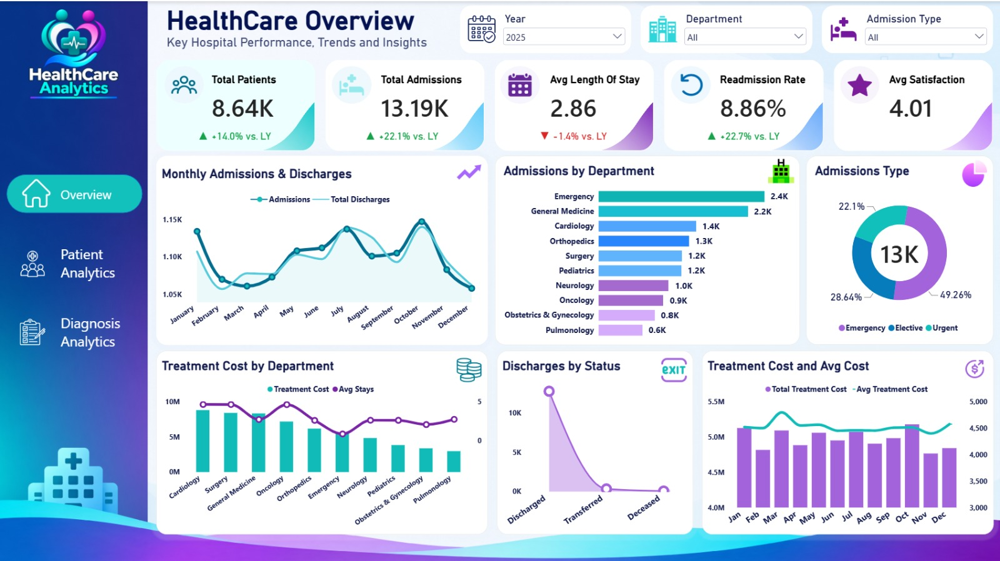
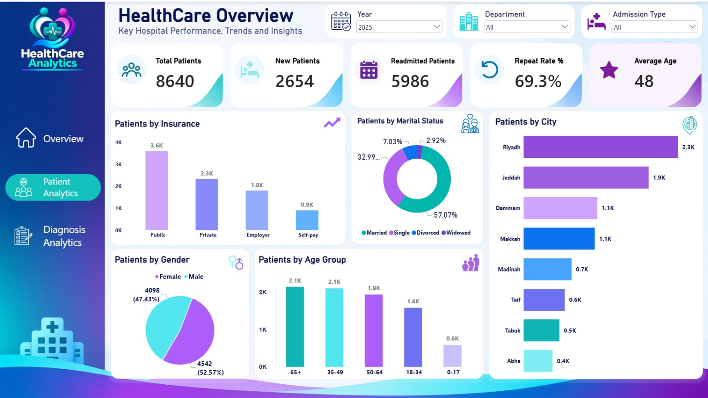
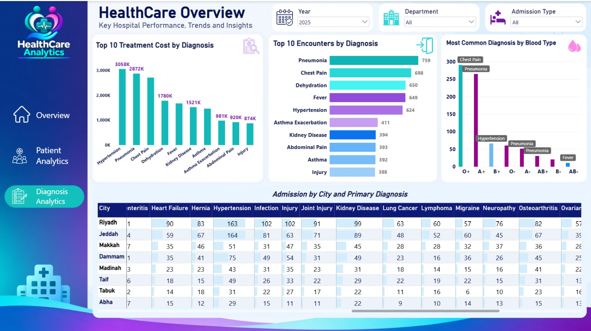

# Healthcare Analytics – Hospital Performance & Patient Insights

## Dashboard Preview

### 1. Healthcare Overview

## Project Overview

An interactive Healthcare Analytics solution developed using Power BI to analyze hospital performance, patient demographics, admission patterns, treatment costs, and clinical diagnosis trends.

The project transforms raw healthcare data into actionable insights that support hospital performance monitoring and data-driven decision-making.

## Tools & Technologies

- Power BI Desktop
- Power Query
- DAX
- Excel

## Dataset Overview

The project uses a synthetic healthcare dataset covering the period 2022–2025.

- 40,000 Hospital Encounters
- Approximately 16,000 Patients
- Department and Diagnosis Dimensions
- Dedicated Calendar Table

## Dashboard Pages

### 1. Healthcare Overview

- Monthly Admissions & Discharges
- Admissions by Department
- Admissions by Type
- Treatment Cost Analysis
- Discharge Status Analysis

### 2. Patient Analytics

- Total and New Patients
- Readmitted Patients
- Repeat Patient Rate
- Patient Demographics
- Patients by Insurance, Gender, Age Group, and City

### 3. Diagnosis Analytics

- Top 10 Treatment Costs by Diagnosis
- Top 10 Encounters by Diagnosis
- Most Common Diagnosis by Blood Type
- Admissions by City and Primary Diagnosis

## Data Preparation & Modeling

- Cleaned and transformed healthcare data using Power Query.
- Designed a Star Schema data model.
- Established relationships between fact and dimension tables.
- Validated patient birth years and date ranges.
- Developed custom DAX calculations for patient classification and readmission analysis.
- Implemented active and inactive date relationships for admission and discharge analysis.

## Key Challenges & Solutions

- **Readmission Logic:** Rebuilt the 30-day readmission logic after identifying inaccurate original flags.
- **Date Relationships:** Used USERELATIONSHIP to analyze discharges independently from admissions.
- **Data Validation:** Identified invalid birth years and inconsistent date ranges.
- **Patient Classification:** Distinguished new patients from returning patients.
- **Data Limitations:** Excluded bed occupancy calculations because actual bed utilization records were unavailable.
- **Advanced Ranking:** Applied RANKX to identify the most common diagnosis within each blood type.

## Project Objective

To demonstrate practical skills in data preparation, data modeling, DAX development, healthcare KPI analysis, and interactive dashboard design.

👤 Author

Mohamed Hesham

Data Analyst | Power BI | SQL | Power Query | Python | Data Warehouse |
